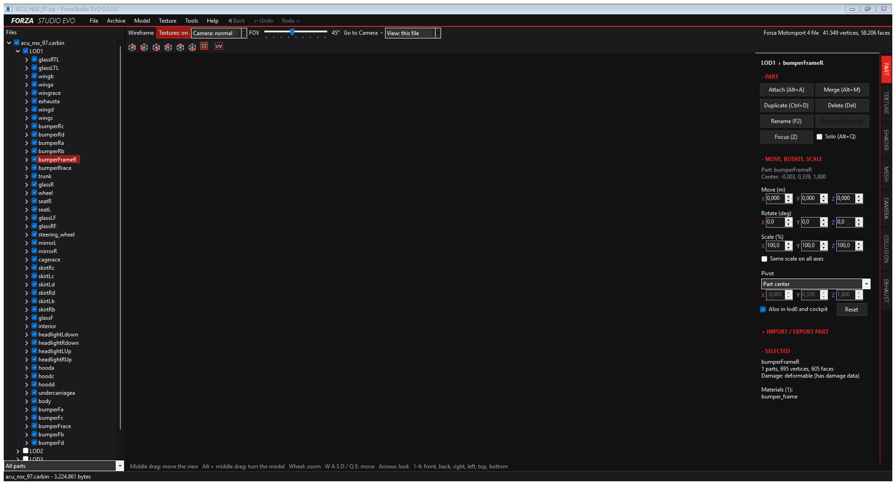
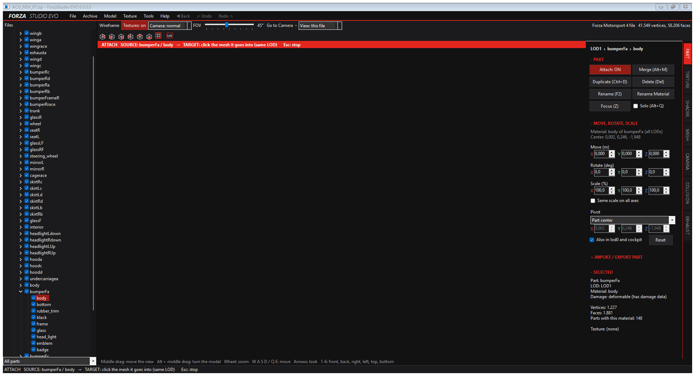
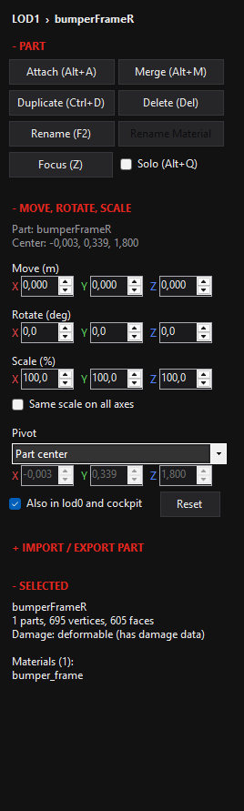

# Editor workflow (TODO 15.3)

User 2026-11-16, after testing Attach / Merge pick modes, Undo / Redo and the move without Apply ("funziona"):
"le interfacce sono veramente difficili da usare ... non è una questione di posizioni, workflow macchinoso e poco
efficiente". Sprint 2 ST-03 (`docs/ST03_PART_IMPORT.md`) is PAUSED for this (user: "fermiamo st per questo").

The user named all four as time sinks: copying parts from another car, moving / scaling parts, confirmations and
windows, materials and textures. Also wanted: 3ds Max shortcuts, the top menus gone, a visible pick-mode banner.

## Rules

- No confirmation or preview window where Ctrl+Z undoes the action. The report goes to the status bar (and
  `PartImport.log` for imports); errors that change nothing still show a message.
- Moving a copied part still ASKS on which LODs (user rule from ST-03), but as part of the same step, not a chain.
- Keys are written on the buttons and in the right-click menu. Ctrl / Alt keys never move the viewport camera.
- One step at a time; the user checks each in the app before the next.

## How the UI is checked here

`E:\DEV\fm4dev\ui\shot.exe <car.zip> <outdir> [part]` opens the editor off-screen (opacity 0, at -4000,-4000),
loads the car's main `.carbin`, selects the part and saves `form.png` and `tab_N_<name>.png` with `DrawToBitmap`.
No screen capture. Copy the fresh `bin\Debug\ForzaStudioEVO.exe` next to it first.

## Screens (2026-11-16, after A.3)

Off-screen renders made with the tool above: the 3D view is empty in them (`DrawToBitmap` does not see it).

The editor with a model open: the archive's file list is hidden (`Files` over the model tree brings it back), the
PART tab starts with the selection's path and its red headings open and close.

Attach on: the thin red strip over the view names SOURCE and TARGET, the button reads `Attach: ON`.

The PART tab alone: actions first, IMPORT / EXPORT PART closed, the selection's details at the bottom.

## Steps

### A. Fewer windows, keys, pick banner — coded 2026-11-16, app test pending

| Before | Now |
|---|---|
| Delete: Yes / No window | deleted at once, status says "Ctrl+Z: undo" |
| Duplicate: name window, then OK | copy gets the next free variant name (exhausta -> exhaustb, `SuggestPartName`) and its name opens for editing in the tree |
| Copy Part From Another Car: car -> parts -> LODs -> text preview -> Apply | the text preview is gone (applied, warnings counted in the status bar, log in `PartImport.log`) |
| Fill missing LOD0 parts: list -> preview -> Apply | list -> applied |
| PART tab 1232 px high (885 visible): Attach / Merge / import below the fold, four paragraphs of notes | 871 px: actions first (Attach, Merge, Duplicate, Delete, Rename, Focus, Solo), notes moved to tooltips, "Also in lod0 and cockpit" + Reset on one row |
| pick mode only shown by the red button and the status bar | red banner over the viewport says what the next click does; a click on it stops the mode |

Keys (`HandlePartKey` in `ArchiveEditorForm.PickMode.cs`, model page, not while typing in a box):
Alt+A Attach, Alt+M Merge, Ctrl+D Duplicate, Alt+Q Solo; with the model tree or the viewport focused: Del Delete,
F2 Rename, Z Focus. Esc ends a pick mode. W A S D / Q E camera moves are ignored while Ctrl or Alt is held.

#### A, second round (user feedback 2026-11-16 night) — coded + built, app test pending

- The face tools (vertex / edge / face / polygon / element, selection region, select all / none / linked, delete,
  detach) moved from the bar over the view into the MESH tab (`BuildMeshToolStrip`, two rows); UV Mapper stays in the bar.
- Attach failed with two meshes of the same name in one part ("2 chrome in un nodo"): the pick mode found nodes by
  tree path, so always the first. Now `PickKey` = path + rank among same-named siblings.
- Attach / Merge go OFF after one join ("quando finisco di attaccare spengo tool"); Esc / right-click stop before.
- The preview windows of Copy Part and Fill LOD0 are BACK ("anteprima andava bene, ma sarà da reworkare": step C).
- PART tab: the SELECTED info block moved to the bottom ("le info meglio al fondo").
- Part keys (Alt+A, Alt+M, Ctrl+D, Alt+Q, Del, F2, Z) only with the PART tab open ("alt-a ed alt-m non devono
  funzionare sempre"); on MESH, Delete deletes faces as before. The tree's own Del / F2 are unchanged.

#### A, third round (user test of round 2, 2026-11-16) — coded + built, app test pending

Round 2 result: face tools in MESH "molto meglio", Attach "molto meglio ma non proprio intuitivo", off after one
join OK, PART tab OK, keys OK, Delete / Duplicate OK. The Copy Part / Fill LOD0 preview: the user wants to rework
it ("questa la vorrei rivedere") — what exactly is still to be asked.

- Crash fixed: MESH tab, then ticking another mesh and clicking = NullReferenceException in `MeshEditOverlayLines`
  (`EnsurePickData` cleared `faceLines` while it was being filled). The lists are now built locally.
- Vertex level: a blue dot on every point of the ticked meshes, the selected ones red, larger, always on top
  (`BuildVertexDots`; `RenderScene.OverlayPoints` / `OverlayPointsOnTop`, point list with a fixed pixel size).
  The red crosses are gone.
- Attach / Merge strip: 20 px instead of 30, text `ATTACH   SOURCE: part / mesh   →   TARGET: ...   Esc: stop`;
  the valid destination under the pointer turns green in the tree and is named as TARGET (`PickHover`).
- Save of a changed game car asks once per car (until the editor closes): MOD PACK or OVERWRITE the game's file
  (`ChooseSaveTarget`, `AskSaveTarget`, `OverwriteGameCar` in `ArchiveEditorForm.PackageCars.cs`). Asked for a
  DVD1 car opened from the database (copy) or as the zip itself (mod pack = the save goes to a copy, the game's
  zip stays). Not asked for original DLC cars (mod pack only) nor when the copy carries its database.

Third round checked by the user in the app 2026-11-16: crash, vertex dots, Attach strip, Save question all OK.

RESUME HERE (2026-11-16 late): A.3 committed (8f6b3be). Step B part handles (Select/Move/Rotate/Scale buttons,
Q/W/E/R, Scale centre triangle, no keyboard camera) OK in the app. MESH-tab handles (vertex/edge/face drag, only the
open LOD) OK in the app (user tests 1-6 all OK). User then saw the view and tree get very slow / go wrong soon
after editing: cause = a new XNA VertexDeclaration on every mesh draw and overlay pass, never released (harness
fm4dev\ui\vdecl: 20000 kept 6 MB after GC); the handles redraw on every mouse move so it grew fast. Fixed: one
declaration per device (ForzaMesh.DeclarationFor, RenderScene.ColorDeclaration), exe 22:21: user "va meglio".
Then: on release the view and tree showed everything (default LOD0 view) and came back = the full reload. Fixed:
RefreshMeshesInPlace (MeshGizmo.cs) gives the tree's meshes the file's new vertices/indices, no tree rebuild; also
for undo/redo of steps labelled "Mesh: " (UndoRedo.cs); full reload only if parts/materials differ. Exe 22:24,
user "ok funziona". Step B COMMITTED 5e853ec.
Step C = preview of the selected part in the Copy Part dialog (see C below; the donor-in-viewport idea was rejected
and removed). Approved by the user ("ottimo lavoro") and committed with the Copy Part rules (see C). Open question
to the user: moving a whole part node (exhausta) - was it picked in the tree or by a click on the car (a single
click selects one material, a double-click the part)? Next after that: step D (TEXTURE / SHADER tabs), describe it
to the user before building. The other chat's files (Fm3Perf.cs, Fm4Perf.cs, CarPerformance.cs, CarDuplicate*.cs,
their csproj lines, docs/FM3 + docs/FM4 PI_AND_RATINGS.md, docs/TODO_WIDEBODY_FUTURE.md) are never committed here.
Fill LOD0 preview is fine as it is (its database rows: later).
2026-11-16 night: user answers: double-click = whole part is fine (exhausta question closed); SHADER tab stays as
it is; wanted a help of the viewport commands. Built: C.1 below (exe 23:56), app test pending. Next: D = TEXTURE only.

### UX direction after round 2

The remaining problem is not just where controls are placed. The editor exposes the archive, model hierarchy,
viewport, transforms, import/export and selection information at the same time. Common operations make the user
move repeatedly between distant areas and remember which selection or mode is active.

The target workflow is viewport-first:

`select a part -> W / E / R -> drag the handle -> Ctrl+S`

- After opening a `.carbin`, collapse or hide the archive tree automatically. Keep a visible button to bring it
  back; give the model tree and viewport the working space.
- Select a part both from the model tree and directly on the car in the viewport.
- Use 3ds Max-style `W` Move, `E` Rotate and `R` Scale tools with X / Y / Z handles. Double-click or `Z` focuses
  the selected part.
- Make the right panel contextual: show tools for the current selection instead of all available operations.
- Keep the selection header visible at the top (part, LOD, mesh/material). Use collapsible `Transform`,
  `Part Operations`, `Import / Export` and `Info` sections; only `Transform` is open by default.
- Make the inspector slightly wider so X / Y / Z values are not cramped. Keep Attach, Merge, Duplicate and Delete
  in one compact action strip. Technical details and material lists stay collapsed until requested.
- In step C, show the donor car in the viewport and drag its parts to the target car. Dialogs remain only for a
  choice that cannot be inferred, such as the target LODs. Reversible actions report to the status bar.

#### Responsiveness

Part numeric fields currently call `UpdatePartPreview()` on every `ValueChanged`; that walks the model tree and
forces `scene.Update(true)`. A drag handle would amplify this cost. Before or as part of step B:

- cache the meshes belonging to the selected part instead of finding them again for every mouse movement;
- coalesce mouse/value changes into at most one viewport redraw per frame;
- let the viewport timer perform the redraw instead of forcing a synchronous full render for every mouse pixel;
- update labels and side panels only when their displayed values actually change.

When testing perceived slowness, record the action being performed, where the workflow caused hesitation, which
control was being searched for, and the exact status-bar text if an operation fails or stalls.

### A.3. Focus workspace and responsive preview — proposed after round 2 test

Before adding more always-visible controls, make the current workspace calmer and the live preview cheaper:

1. Auto-collapse/hide the archive tree after a model opens, with an obvious way to restore it.
2. Add the persistent selection header and collapsible contextual sections to the PART inspector.
3. Cache the selected part's mesh set and coalesce preview redraws.
4. Test this pass in the app before proceeding to the viewport handles.

Coded 2026-11-16 (compiles; app test pending):

- `Files` button, first in the view's bar: the archive tree hides by itself when a model opens
  (`ArchiveTreeFollowView`, called by `ShowView`); the button brings it back and its state is kept
  (ForzaStudio.ini `Editor.ArchiveTreeWithModel`).
- PART tab: first line = the selection's path (`LOD1 > bumperRo > black`, `UpdatePartHeader`); the red headings
  open / close their section with a click (`MakeCollapsible`, state kept as `Editor.Section<NAME>`);
  IMPORT / EXPORT PART starts closed.
- `UpdatePartPreview` keeps the part's meshes (`previewPart`) until the selection or Solo changes and only asks
  for a redraw (`viewRedrawWanted`); `modelTimer_Tick` draws once per tick.
- Not done: updating labels only when their values change (nothing found that needed it yet).

### B. Move / scale handles in the viewport — next

Select parts from the tree or viewport. Use `W` for Move, `E` for Rotate and `R` for Scale, then drag X / Y / Z
handles on the selected part (like 3ds Max). The number boxes stay for exact values; double-click or `Z` focuses.

First cut coded 2026-11-16 (compiles; app test pending) - `ArchiveEditorForm.MoveGizmo.cs`:

- Move only. With the PART tab open and a part or a material selected, three arrows start at its centre (X red,
  Y green, Z blue, 90 px long at any zoom; the one under the pointer turns yellow). Dragging one with the left
  button drives the Move box of that axis, so it is the same preview as typing: kept until Save, one Ctrl+Z step
  per drag, LODs as "Also in lod0 and cockpit" says.
- No W key yet: W / E are camera moves (W A S D / Q E) while the view has the focus. The arrows are simply there
  when a part is selected. To decide with the user before Rotate (E) and Scale (R) are added.
- A click on the car already selected the mesh under the pointer (`ArchiveEditorForm.ClickPick.cs`); new: a
  double-click selects its whole part (`SelectPartAt`).

Second cut 2026-11-16 (user: Move "sembra ok", wants Select / Move / Rotate / Scale buttons as in 3ds Max; built,
app test pending):

- Four buttons first in the view's bar (`AddGizmoToolButtons`), the choice kept as `Editor.Tool`. Select = no
  handles; Move = arrows; Rotate = three rings around the pivot; Scale = three lines ending in a square (all three
  axes with "Same scale on all axes"). No keys: Q / W / E / R are camera moves.
- Rotate reads the angle where the pointer's ray meets the ring's plane; a ring seen edge-on is refused with a
  status text. The three Rotate boxes are applied X, then Y, then Z, so with two of them non-zero a ring is not
  exactly the axis the part turns around.
- 2026-11-16 later: W A S D no longer move the camera (user rule; Q / E and the arrows stay). Scale has a centre
  triangle that scales the three axes together (pointer right / up = larger). Built, app test pending.
- 2026-11-16 later (user: "tutto ok, passa a vertici e facce"): Q W E R are the tools (no camera move from the
  keyboard at all, user rule); every start is Select; icons on the four buttons.
- The same handles on the MESH tab's selection (vertex, edge, face, polygon, element), `ArchiveEditorForm.MeshGizmo.cs`
  + `CarbinModel.MoveVertices.cs`. USER RULE: these free edits change ONLY the LOD of the mesh. The handles start at
  the centre of the selection; while dragging, the points and the red selection follow (preview only,
  `ForzaMesh.PreviewVertices`); on release the move is written to the open model file, one Ctrl+Z step, and the
  selection is put back. A point the other materials of the same LOD share (a seam) moves for all of them; a point
  another LOD uses is copied first, so the other LODs stay. The PART tab keeps "Also in lod0 and cockpit".
  Headless check `E:\DEV\fm4dev\ui\movevert\mv.exe <car.zip>`: NSX 35 meshes (LOD 1, lod0, cockpit), moved faces at
  the right place, other LODs unchanged, file reads back: 35/35 OK. App test pending.

### C. See the part in the Copy Part dialog (redefined by the user 2026-11-16)

Old plan (donor car ghosted beside this one in the viewport, drag a part onto the one it replaces) was built and
REJECTED by the user: "non devo sostituire. io volevo vedere anteprima del nodo selezionato nella schermata di
selezione". Removed completely; do not propose it again.

What C is: the Copy Part dialog stays as it was (car list, part table, Replace / Name / options, LOD question,
preview report). On its right, PartPreviewControl is a small XNA viewport (RenderScene, the editor viewport's
technique; user 2026-11-16 "usa tecnica viewport" after a first software z-buffer cut that was slow and ugly): the
source car's main model, each part at its lowest LOD in that file, materials from its shadersettings.xml, NO
TEXTURES (user: "non visualizzare texture sul nuovo viewport"); the highlighted and ticked rows drawn selected
(orange). Left drag or Alt + middle turns, middle drag moves, wheel zooms; parts not in the main model are named in
the bottom note. PickDialog.AddPreview + MarkedKeys. Smoke test E:\DEV\fm4dev\ui\donor\preview.exe <car.zip>
<part...>: no exception, ~17 ms per redraw (Integra R). User 23:20: "funziona".

Copy Part rules (user 2026-11-16, built 23:22, app test pending, uncommitted):
- By default NOTHING is replaced. "Replace in this car" starts on "(nothing: add as a new part)" whatever part is
  in edit; replacing only when the user picks a part there.
- New part name = FreePartName against every part of this car's model files: own name if free, else the next
  variant (exhausta -> exhaustb -> exhaustc; seatL -> seatL_2), proposed in "Name in this car" for the highlighted
  row; a typed name that is taken is refused with a message. Several ticked parts: each added under its free name.
- FH1 / FH2 source cars (FH carbin, IsHorizon) are refused with an FM3-style message ("Forza Horizon .carbin: it can
  be read for study, but copying parts from FH models is not supported.").
- FM2 is now in the game list (CarSourceGames; 310 cars of FM2_Extracted, main model found 310/310) and refused the
  same way ("Forza Motorsport 2 .carbin: it can be read for study, but copying parts from FM2 models is not
  supported."). Built 23:26. User: "il resto mi sembra molto buono".
- User 2026-11-16: preview too small -> AddPreview asks 900 px, clamped to the screen's working area, dialog up to
  860 px high, centred on the screen. A stray double-click on a row copied the part -> PickDialog.DoubleClickAccepts,
  false for Copy Part (only the Copy button copies).
- User "anteprima falla scalabile. ottimo lavoro": the preview keeps its share of the dialog width on resize /
  maximise; dragging the splitter sets a new share; list at least 300 px. Off-screen check (fm4dev\ui\donor\scale.exe):
  1458 -> 900, 1924 -> 1174, 884 -> 539. Exe 23:33.
- Open question to the user: "regression" on moving a whole part node (exhausta) vs only its materials.

### C.1. Viewport commands help (user 2026-11-16) — built, app test pending

F1 or the "?" button at the end of the viewer's tool bar opens "Viewport commands" (ViewportHelp.cs, wired in
ArchiveEditorForm.Help.cs): a non-modal tool window at the viewer's top right that does not take the focus, so the
keys keep going to the viewer. F1 again (or Esc in it) closes it. Groups: VIEW, SELECTION IN THE VIEW, TOOLS,
PART TAB, MESH TAB, ALWAYS; the group of the side tab in use goes first with "(this tab)" in red and follows tab
changes. ONE table (ViewportHelp.Groups): when a key or mouse action changes, change it there too.
Off-screen check: fm4dev\ui\help\helpshot.exe <exe> <outdir> (help_Part.png, help_Mesh.png).

### D. Materials and textures

SHADER: stays as it is (user 2026-11-16). TEXTURE only, agreed: fixed header line (material, parts, LOD); texture
combo with a small "..." for From File; the two ticks under it; taller UV box framed on the material's UVs (today it
shows the whole 0-1 space, the UVs end up tiny in a corner) with the info line under it; the long "(auto)" text
becomes the combo's tooltip. Layout and UV framing only, no change in what it does.
2026-11-17 built (exe 00:19, app test pending, uncommitted): user "funziona" on C.1, "vai con texture". Header
(UpdateTextureHeader, Materials.cs): "material · N parts · LOD" for a material node, "part · N materials · LOD" for
a part. Texture combo + "..." (Texture From File), explanation as tooltip; headings collapsible (MakeCollapsible,
both open). UV LAYOUT: UV set, box 236 x 300 framed on the selection's UVs (UvForm.Frame through the indices,
4 % border; Render(width, height, view); the old square Render is the 0..1 case), info line, Open In Window.
Off-screen (fm4dev\ui\out\tex*): material-node selections frame tight; a part node with several materials spreads
(each material has its own texture space), e.g. exhausta UVs at both edges of the texture.

### E. Top menus become buttons

File / Archive / Model / Texture / Tools turn into visible buttons and keys.
